# Color Data Master

A Blender 5.2 LTS extension for editing, converting and transferring color channel data on **vertex colors and textures** from one panel. It is a rebuild of Vertex Color Master (Andrew Palmer, GPL) for the color attribute system, with texture support added.

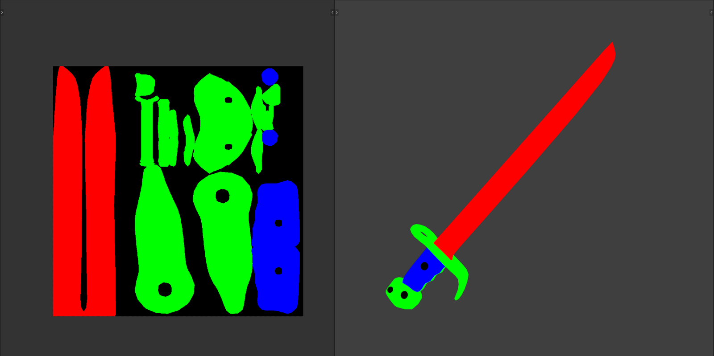

## Install

The easiest way is to add this project as an extension repository, so Blender can install it and tell you about updates:

1. Edit > Preferences > Get Extensions > **Repositories** (the dropdown at the top right) > **+** > **Add Remote Repository**.
2. URL: `https://bustercharlie.github.io/color-data-master/index.json`. Tick **Check for Updates on Startup**.
3. Search for Color Data Master in Get Extensions and click **Install**. New releases then show an **Update** button.

Or download `color_data_master-<version>.zip` from [Releases](https://github.com/BusterCharlie/color-data-master/releases) and use **Install from Disk** in the same dropdown.

To work on the code, add the folder that holds your `color_data_master` clone as a local repository (Repositories > **+** > Add Local Repository). Restart Blender after pulling changes.

The panel is in the 3D Viewport sidebar (N), on the **Color Data** tab, in Object, Vertex Paint and Texture Paint mode.

## Building

GitHub Actions validates and builds the zip on every push and pull request. Download it from the run's **Artifacts**.

Every merge to main also updates the extension repository on GitHub Pages. Blender only offers an update when `version` in `blender_manifest.toml` goes up, so bump it in any PR you want people to receive. Pages must be set to **Source: GitHub Actions** in the repository settings.

To also attach the zip to a GitHub release, push a tag matching the version (for example `git tag v1.1.0 && git push origin v1.1.0`).

To build locally, run `blender --command extension build` in this folder.

## What it edits

- **Vertex Paint / Object mode:** the active color attribute, any type: byte or float, Vertex or Face Corner.
- **Texture Paint:** the image being painted (the active material paint slot, or the canvas in Single Image mode).
- **Edit Target** overrides that choice, for example to edit a texture from Object mode.

  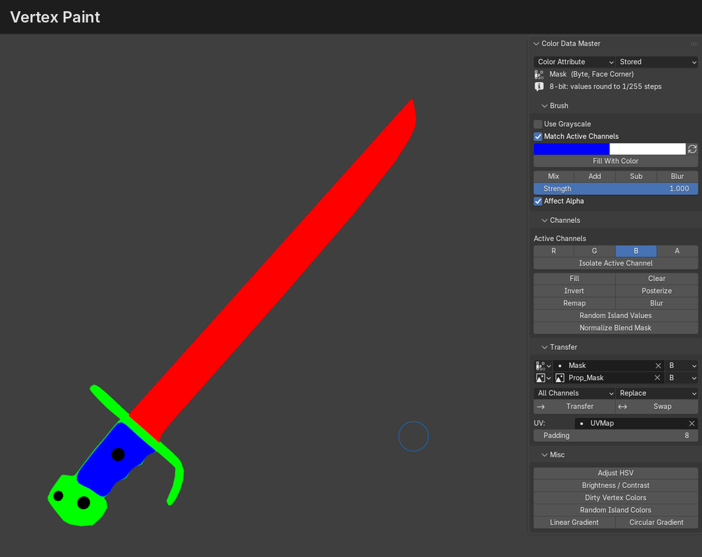
  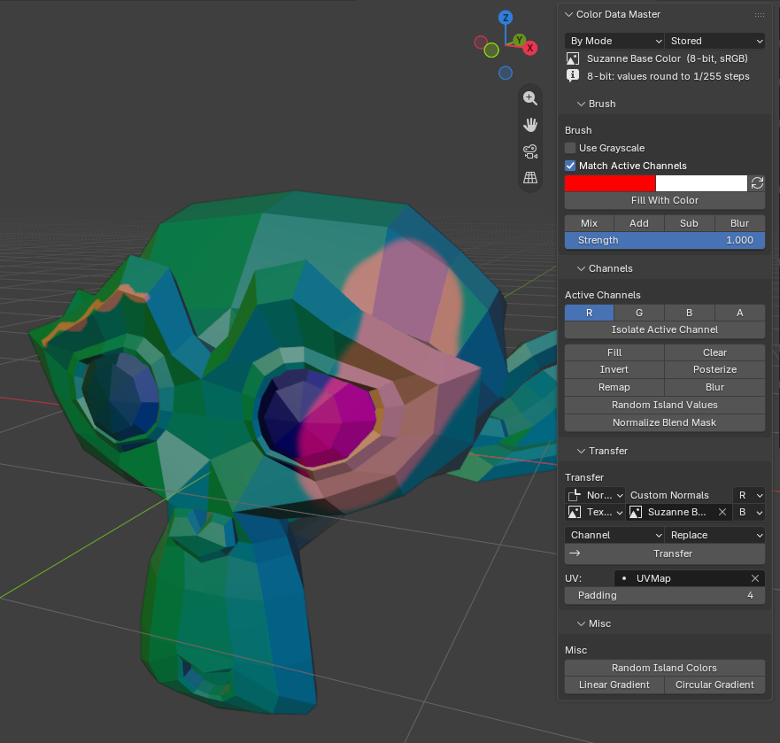

## Values: Stored, Linear, sRGB

Byte color attributes and 8-bit sRGB images store sRGB numbers. Float attributes and float images store linear numbers. Shaders always read linear, so a byte mask value of 0.5 reaches a shader as about 0.21.

The **Values** dropdown sets how numbers typed into the tools are read:

| Setting | Meaning | Use it for |
| --- | --- | --- |
| Stored (default) | The numbers in the layer, no conversion | Packed masks and game data |
| Linear | What shaders see | Values that drive shading math |
| sRGB | What color pickers show | Matching colors by eye |

The grayscale brush sliders follow the same setting. The panel shows the stored value, and the 0-255 value on byte layers.

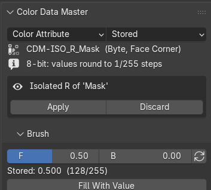

## Tools

### Brush

Colors or grayscale values, Mix / Add / Sub / Blur. These switch to the essentials Paint Hard or Blur brush when needed. **X** flips colors and **V** opens the pie menu.

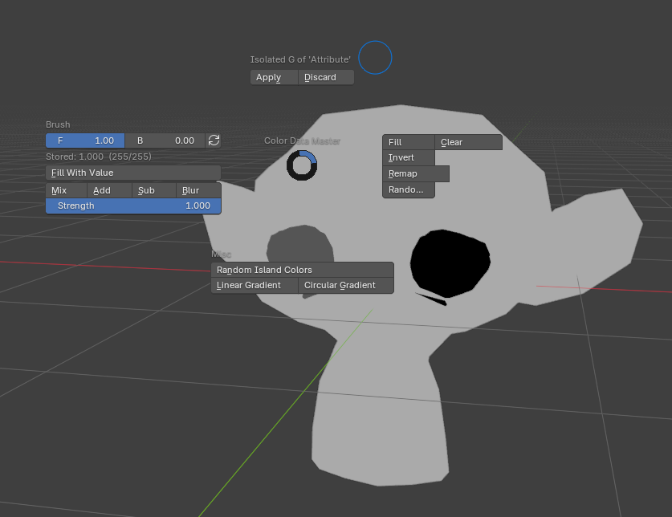

### Channels

Fill, Clear, Invert, Posterize, Remap, Blur, and Random Island Values on the active channels. Vertex and face selection masks are respected, in Texture Paint too.

- **Remap > Auto Range** stretches the values found in the selection to the output range, per channel or with one shared range.
- **Normalize Blend Mask** makes R, G, B and A add up to 1, for 4-layer terrain or material blend masks.
  - **Equal** gives all four channels the same priority. Areas where every channel is 0 stay black, or **Empty** fills them with one channel.
  - **Remainder** scales three channels down to at most 1 in total and gives what is left to the fourth (A by default).
  - It works on the numbers the **Values** setting gives, so pick Linear if a shader reads the mask as blend weights.

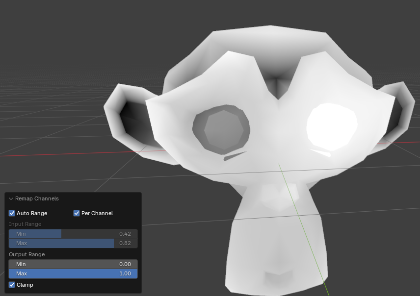

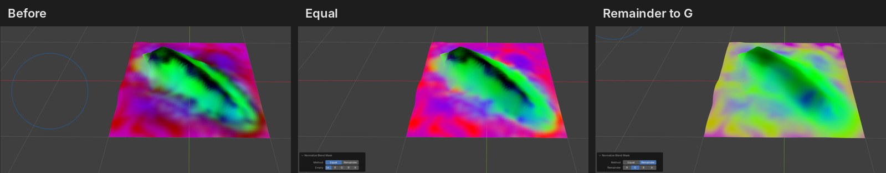

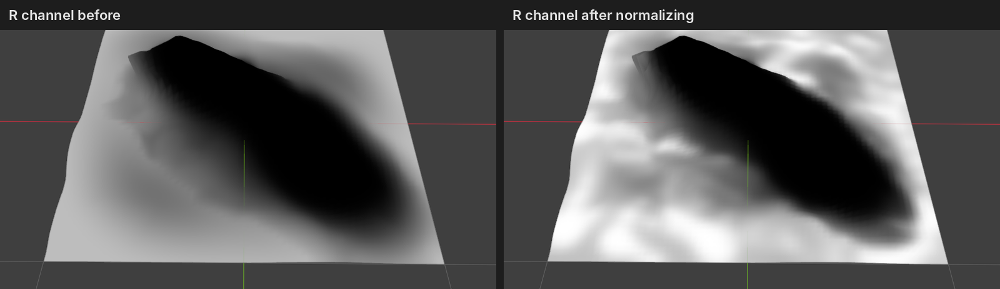

### Isolate Channel

Copies one channel to a temporary grayscale layer (`CDM-ISO_<channel>_<name>`). Paint it with any tool, then use **Apply** or **Discard**. This works on color attributes and textures.

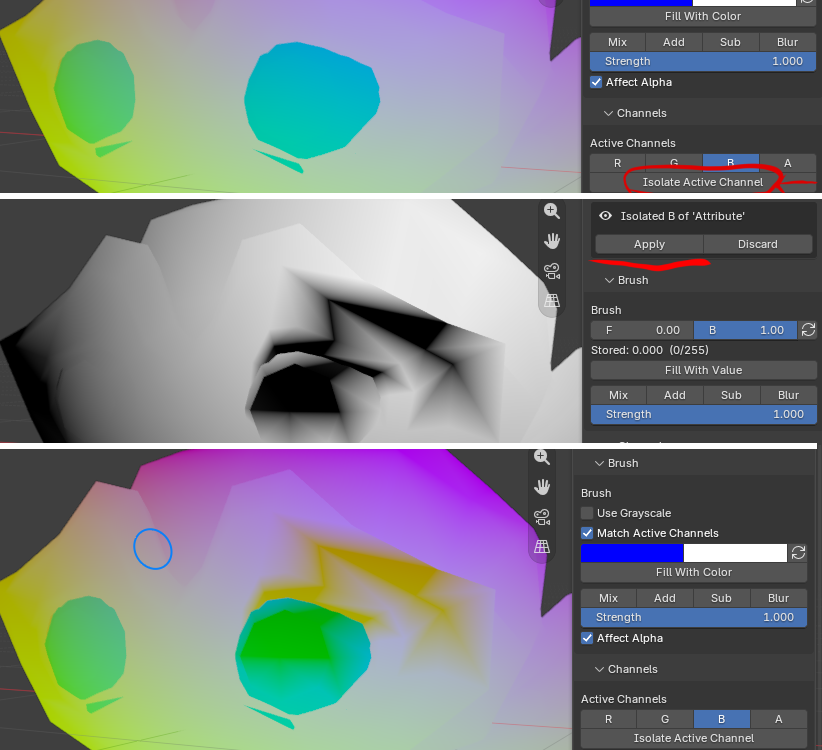

### Transfer

Pick a source and destination from Color, Texture, Weights, UV and Normals. Modes are Channel, Channel to RGB, All Channels and Luminance, with Replace / Add / Subtract / Multiply / Divide / Lighten / Darken.

- A **mesh layer to a texture** is drawn through a UV map, with padding around the UV islands.
- A **texture to a mesh layer** is sampled at each corner's UV.
- **Swap** exchanges a channel between two color layers or textures.
- Into **Weights**, vertices at or below **Skip Weights at or Below** (0 by default) are left out of the vertex group, so it only holds the vertices that carry weight. Untick it to add every vertex.

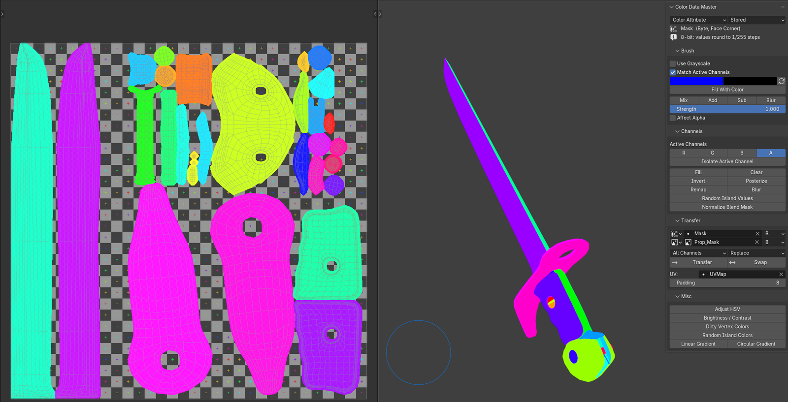

### Islands

**Random Island Colors** gives each mesh island a random hue, saturation and/or value. **Random Island Values** does the same per channel, between Min and Max. Both can **Split at UV Seams**, **Merge Similar** islands (same face count), and use **Order Based** to space the values evenly instead of randomly.

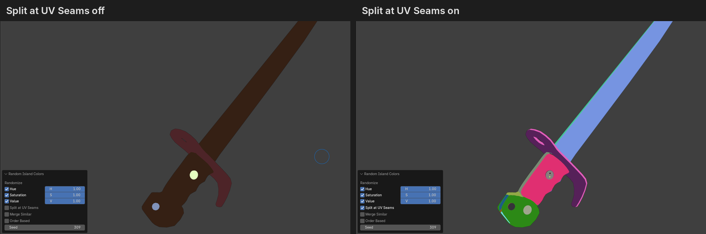

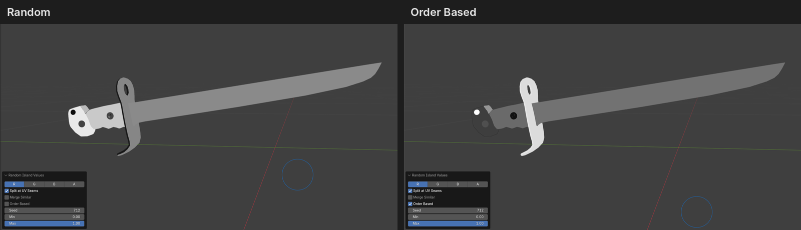

### Misc

Linear and Circular Gradient (drag in the viewport), plus Blender's HSV, Brightness/Contrast and Dirty Vertex Colors in Vertex Paint.

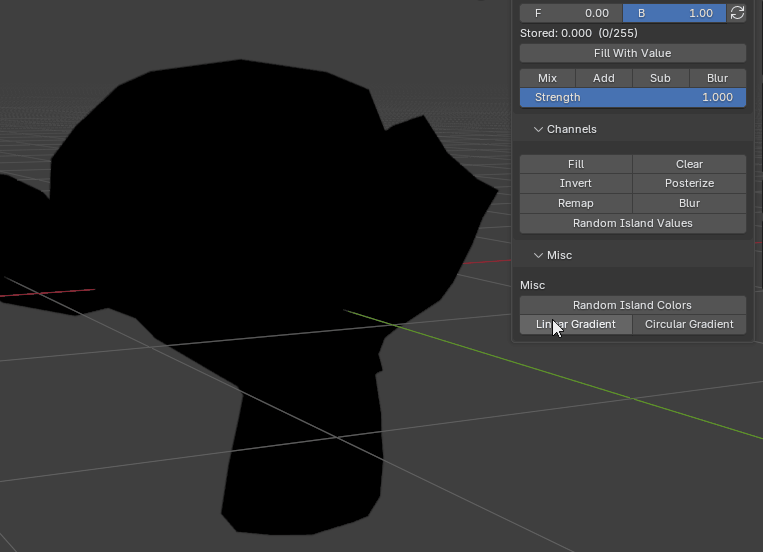

## Notes

- Texture edits change the image in memory. Save the image (Image > Save) to keep them.
- Islands are found by mesh connectivity. With **Split at UV Seams** on (the default, like the original add-on), UV seams split them too.
- Vertex Color Master's isolate layers (`VCM-ISO_...`) are not recognised. Apply them in the old add-on first.
